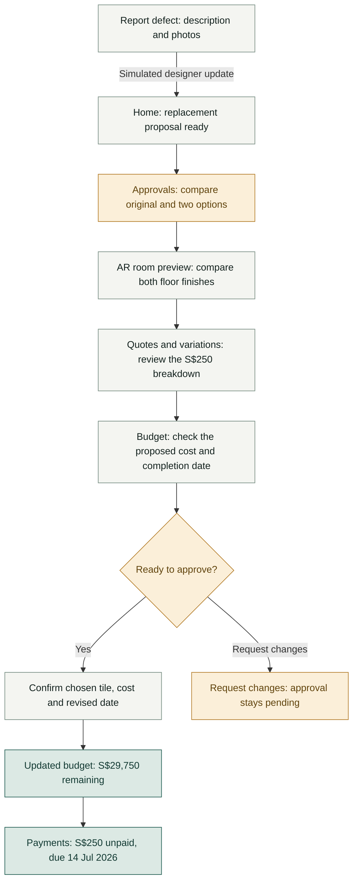

# RenoGuard

*Renovate with proof, not promises.*

RenoGuard is a mobile-first renovation management prototype that helps homeowners track defects, compare proposed changes, and review their impact on costs and completion dates before approving work.

Created for **SMU IS211 — Interaction Design and Prototyping**.

<br>

## ✨ Features

- **Project dashboard** — progress, pending decisions and recent updates.
- **Interactive room overview** — explore rooms, open defect records and preview finishes.
- **Simulated AR preview** — compare bathroom floor tiles with live visual changes.
- **Defect tracking** — report issues with photos and verify completed repairs.
- **Change approvals** — compare materials, review quotations and confirm variations.
- **Budget and payments** — track approved costs and upcoming payment milestones.
- **Demo modes** — follow the bathroom walkthrough or explore project issues, with separate saved progress.
- **Review variants** — compare a consolidated approval page with a guided review.

<br>

## 📱 Preview

App screenshots will be added once the prototype is finalised.

<!-- Add final app screenshots here. -->

<br>

## 🛠️ Technology

- **Frontend:** HTML, CSS and vanilla JavaScript
- **Preview server:** Node.js
- **Demo storage:** Browser local storage

No backend or package installation is required.

For static hosting, serve the repository root. `index.html` opens the mobile app; no build command is needed.

<br>

## 🚀 Getting started

New to the project? Follow the [Windows and macOS setup guide](docs/setup.md).

To share a public link for participants, follow [Hosting and Loop11 setup](docs/setup.md#publish-online-with-github-pages).

With [Node.js](https://nodejs.org/) installed, run this command from the project folder:

```sh
node preview-server.cjs
```

| View | Local address |
| --- | --- |
| Mobile app | [http://127.0.0.1:8765/](http://127.0.0.1:8765/) |
| Desktop interface | [http://127.0.0.1:8765/web/](http://127.0.0.1:8765/web/) |

The mobile app automatically appears in a phone-sized frame on computers.

**Stop the preview server**

Press <kbd>Ctrl</kbd> + <kbd>C</kbd> in the terminal.

*If images or styles do not load, use the local address above instead of opening the HTML file directly.*

<br>

## 📁 Project structure

```text
renoguard-prototype/
├── mobile/              Mobile interface and interactive room renderer
│   └── comparison.js    Shared tile choices and approval review components
├── web/                 Desktop interface
├── shared/              Shared project rules and demo storage
├── assets/              Room images and tile samples
├── docs/                Windows and macOS setup guide
├── drafts/              Earlier HTML screen explorations
├── preview-server.cjs   Local preview server
├── index.html           Mobile app entry point
└── README.md            Project overview
```

<br>

## 🎬 Walkthrough

The easy scenario follows a bathroom defect through quotation review and approval to the updated budget and payment records. Room previews, source documents and budget details can be revisited during review.

**Walkthrough steps** and **Reset demo** are available from Project tools, Profile and the approval receipt, even with walkthrough hints off.



<br>

| Video | Link |
| --- | --- |
| High-fidelity walkthrough | Coming soon |
| Low-fidelity walkthrough | [Watch on YouTube](https://www.youtube.com/watch?v=oRJ63LUH_NY) |

<!-- Add the high-fidelity walkthrough URL when the recording is ready. -->

<br>

## 🧪 Prototype versions

Open **Profile → Prototype setup** to switch versions or configure walkthrough hints.

| Version | Approval review | Local preview |
| --- | --- | --- |
| A | Tile choice, cost and timing, and confirmation together | [Open version A](http://127.0.0.1:8765/?variant=a) |
| B | Guided steps: Tile → Cost & timing → Confirm | [Open version B](http://127.0.0.1:8765/?variant=b) |

Saved progress is separate for each version. Fresh A/B previews start the bathroom scenario with hints off. For filming, turn hints on and reset the demo.

Both use the same tile choices, quotation facts, sources and approval safeguards. Each tile adds S$250, leaving S$29,750, with completion proposed for 14 Jul 2026. The comparison tests how the review is organised.

Use the previews above for development and filming. For participants, choose the same experiment scope for A and B:

| Fresh experiment | Version A | Version B |
| --- | --- | --- |
| Complete easy scenario, starting at Home | [Preview A](http://127.0.0.1:8765/?variant=a&study=scenario) | [Preview B](http://127.0.0.1:8765/?variant=b&study=scenario) |
| Approval review, starting with a pending quotation | [Preview A](http://127.0.0.1:8765/?variant=a&study=quotation) | [Preview B](http://127.0.0.1:8765/?variant=b&study=quotation) |

Both experiment modes start fresh on reload. Publish the repository once to host both versions; the [hosting and study guide](docs/setup.md#publish-online-with-github-pages) provides public starting URLs and Loop11 setup.

<br>

## 🎨 Design resources

- [Figma design and prototype](https://www.figma.com/design/ffrTmJHTCUY2NdfNZG7SkK/RenoGuard---High-Fidelity?node-id=1-2)
- [Earlier HTML drafts](http://127.0.0.1:8765/drafts/) — available with the preview server running
- [Project pitch](https://www.youtube.com/watch?v=1Q7eNqnpxkM)

*Bathroom imagery and tile samples are adapted from the project's Figma design.*
