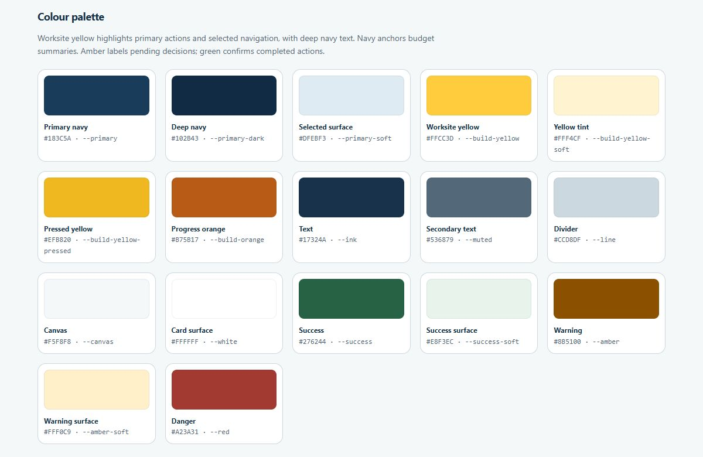
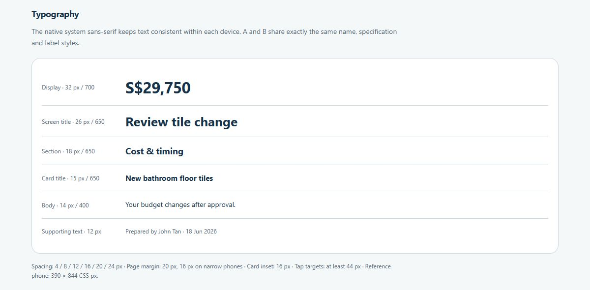
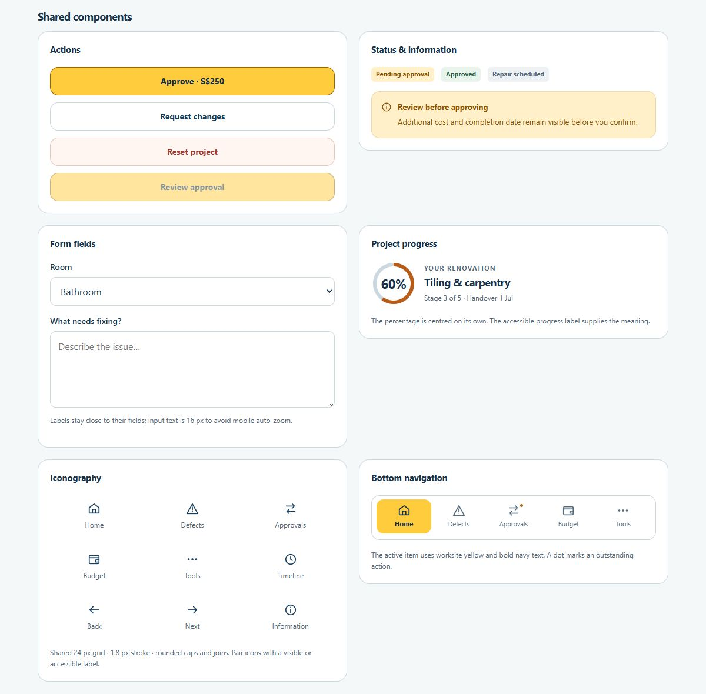

# RenoGuard design system

Shared rules for the construction-inspired mobile prototype. The palette takes its cue from worksite signage and hard hats: yellow for primary actions and selected navigation, navy for readable text and budget summaries, and orange for progress. The mark is an original upright hard hat; the app does not use character artwork.

**[Open the live colour and component sheet →](https://renoguard-prototype.vercel.app/docs/design-system.html)**

The images below display directly on GitHub. The hosted sheet includes interactive examples and loads the same stylesheet and comparison component as the app. For local changes, use the preview server's `/docs/design-system.html` page.

[Back to the project README](../README.md)

 

## 🎨 Colour foundations

Colour tokens and usage

| Colour / token | Hex | Use |
| --- | --- | --- |
| Primary navy · `--primary` | `#183C5A` | Budget summaries, links, icons and selected tile outlines |
| Deep navy · `--primary-dark` | `#102B43` | Text on yellow actions, loading screen |
| Navy tint · `--primary-soft` | `#DFEBF3` | Selected tiles and information surfaces |
| Worksite yellow · `--build-yellow` | `#FFCC3D` | Primary actions, active bottom navigation, Home summary accent, logo and budget usage |
| Yellow tint · `--build-yellow-soft` | `#FFF4CF` | Selected tabs and navigation icon backgrounds |
| Pressed yellow · `--build-yellow-pressed` | `#EFB820` | Hover and press feedback on enabled primary actions |
| Progress orange · `--build-orange` | `#B75B17` | Completed portion of the progress ring |
| Ink · `--ink` | `#17324A` | Primary text |
| Muted · `--muted` | `#536879` | Labels, captions and secondary text |
| Line · `--line` | `#CCD8DF` | Borders, dividers, unfilled progress |
| Canvas · `--canvas` | `#F5F8F8` | App background |
| Surface · `--white` | `#FFFFFF` | Cards and fields |
| Success · `--success` | `#276244` | Approved and verified status text |
| Success tint · `--success-soft` | `#E8F3EC` | Success status background |
| Warning · `--amber` | `#8B5100` | Pending decisions and cost warnings |
| Warning tint · `--amber-soft` | `#FFF0C9` | Warning backgrounds |
| Danger · `--red` | `#A23A31` | Destructive actions and field errors |
| Focus · `--focus` | `#9A6200` | Keyboard focus outlines |

Use named tokens in `mobile/styles.css`. Colour supports a text label, icon or checked state; it does not carry status alone. Yellow action surfaces use deep navy text. Keep warnings labelled in amber and completed actions labelled in green.

Checked contrast pairs: deep navy on worksite yellow **9.63:1**, deep navy on pressed yellow **7.97:1**, white on primary navy **11.46:1**, muted on canvas **5.43:1**, warning on its tint **5.67:1**, success on its tint **6.33:1**, and progress orange against the track **3.20:1**. These checks cover the named pairs, not a claim that every possible state has been independently certified.

 

## 🔤 Typography

Use the device's native sans-serif stack: Apple system font on Apple devices, Segoe UI on Windows, then Arial/sans-serif. No font installation or external font service is required.

Type sizes and usage

| Role | Size | Weight | Usage |
| --- | --- | --- | --- |
| Display number | 32–33 px | 650–700 | Main remaining-budget figure |
| Screen title | 26 px | 650 | One main heading per screen |
| Section heading | 18 px | 650 | Groups such as Cost & timing |
| Card title | 15 px | 650 | Records and menu items |
| Body | 14 px | 400 | Descriptions and instructions |
| Supporting text | 12 px | 400–500 | Dates, notes and secondary labels |
| Small navigation label | 11 px | 400–650 | Bottom navigation and short metadata |
| Form input | 16 px | 400 | Typed text and form selections; avoids iOS focus zoom |
| Progress figure | 22 px | 700 | Centred percentage, without a second label |

**A/B comparison typography is fixed across both layouts:** option names **14 px / 650 / 1.5 line height**; specification values **13 px / 400 / 1.5**; specification labels **13 px / 500 / 1.5**; option labels and notes **12 px / 1.5**. Both use **48 × 48 px** material samples and the same 18 px native radio circle. Never reduce just one variant's type to fit its layout.

A large desktop monitor does not enlarge the app's CSS font sizes. The desktop preview is a 390 × 844 frame and scales down as a whole when the browser window is shorter. Real phones use their available width; text keeps its role-based size and wraps naturally.

 

## 📐 Spacing and alignment

- Use the **4 / 8 / 12 / 16 / 20 / 24 px** rhythm.
- Page edges: **20 px**, changing to **16 px** below 360 px wide.
- Unboxed headings: **4 px** inside the card edge. This creates a small optical inset without looking detached.
- Card content: **16 px** inside the border. Status, title, metadata and actions share that inset.
- Budget trade breakdown: heading, labels, bar endpoints and note share the card's content edges. Amounts align on the right; pending additions sit on a separate line below the relevant bar.
- Label-to-field gap: **8 px**. Helper text follows its field by **8 px**.
- Section spacing: **24 px**. Related stacked controls use **12 px**.
- Cards use an **18 px** radius; primary controls use a **14 px** radius unless their component has a specific shape.
- Interactive targets are at least **44 × 44 px**. Tile choices have a **48 px** high invisible target around the radio.
- Keep tap controls and text in separate grid/flex columns with a defined gap; never use adjacent inline text without spacing.

Keep one shared rule for a component. Add a local exception only when its role actually differs, rather than repeatedly overriding a screen until it looks right.

 

## 🧩 Components and behaviour

| Component | States and rules | Source |
| --- | --- | --- |
| Hard-hat mark | Upright, square proportions, no rotation; reuse at every size | `assets/renoguard-mark.svg` |
| App header | Brand on primary screens; centred title between equal Back/Home controls on detail screens | `index.html`, `.app-header` |
| Bottom navigation | Home, Defects, Approvals, Budget, Tools; current item uses yellow with bold navy text | `.bottom-nav` |
| Primary / secondary / danger action | Yellow primary, white secondary, red-tinted danger; common 48 px height, visible focus, disabled state and press feedback | `.button` |
| Card and record | Shared content inset, border and role-based title size | `.card`, `.record-row` |
| Status pill | Pending / approved / scheduled labels with semantic tints | `.status` |
| Progress ring and stage tracker | 60% centred; ring fills on Home entry and remains accurate after rerenders | `renovationProgress()` |
| Approved cost by trade | Shared card insets; bars show each trade's share of the current approved total, not construction completion | `.budget-trades`, `.trade-bar` |
| Form field | Label, input, helper and error form one group; errors explain the correction | `.field` |
| Defect photo | A thumbnail opens an enlarged sample image; counts stay beside the photo | `.record-thumbnail`, `.defect-photos` |
| Original specification | Material name, size, finish and stock warning appear before either comparison | `originalBrief()` |
| Cost / timeline impact | Same S$250, remaining budget and proposed date in both variants | `impact()` |
| Approval summary | Same chosen tile, figures, acknowledgement and final action in both variants | `selectionSummary()`, `approvalConfirmation()` |

### Version A: swipeable comparison table

A fixed label column remains visible while one replacement option fills the remaining width. Swiping, arrow buttons, position buttons and keyboard arrows all reach the same three positions. The current position reads **Option A/B/C · 1/2/3 of 3**; end arrows disable appropriately. Selecting a tile or returning from its preview retains the relevant option in view.

### Version B: full-width option cards

Each card shares the page gutters. Its information and a **centred radio inside the right edge** occupy separate columns with a 12 px gap. There is no extra selection row, Select/Selected text or outer button box. The checked circle and highlighted card show the pending choice.

The comparison component owns its data and paging behaviour. Both layouts use the same material order, labels, facts, images and choice names. Choosing a tile does not approve it. Budget and payments change only after the common confirmation step.

 

## 🎞️ Motion and loading

- Screen entry: a short **220 ms** fade with an **8 px** rise.
- The main app and full walkthrough may add a light card entrance; focused study sessions use the same page transition in A and B.
- Home progress fills over **900 ms** on entry. The underlying value is always 60%, including rerenders and reduced-motion mode.
- Table navigation scrolls smoothly to a complete option; manual swipe updates the same indicator.
- The startup bar runs while fonts and the bathroom image are prepared. A short minimum presentation keeps it legible; a timeout prevents a blocked loading screen.
- Respect `prefers-reduced-motion`: remove entrance, progress and smooth-scroll animation while preserving every action and final state.
- Keep keyboard focus visible even when a pointer-controlled button has no visible box.

 

## 🖼️ Images and material previews

The original bathroom and grey/sand samples come from the team's earlier design assets. The ivory option uses a visibly different fine mineral texture. `assets/bathroom-avorio.png` was made with the built-in image-generation tool from the original room photo; the app clips its floor material over the original room so fixtures remain in the base image.

Generation brief: **replace only the visible floor with warm ivory matte 600 × 600 mm porcelain containing small grey/taupe mineral flecks; preserve the camera, crop, walls, fixtures, light and grout geometry; no UI or text.** This remains an illustrative material preview, not a live AR camera or a guarantee of installed colour.

 

## 🔧 Maintaining the system

1. Change shared tokens or components before adding a screen-specific override.
2. Check A and B together at 390 px and 320 px, including selected, unselected, keyboard and disabled states.
3. Check the live component sheet after changing a shared style. Refresh the three section screenshots in `docs/images/` so this guide stays accurate.
4. Preserve the same quotation facts and approval safeguards in both variants.
5. Update this guide when a component's role or behaviour changes.

The team's [earlier Figma design system](https://www.figma.com/design/ffrTmJHTCUY2NdfNZG7SkK/RenoGuard---High-Fidelity?node-id=0-1) and [component sheet](https://www.figma.com/design/ffrTmJHTCUY2NdfNZG7SkK/RenoGuard---High-Fidelity?node-id=13-1787) are reference material. The current construction palette and code components are documented here.
