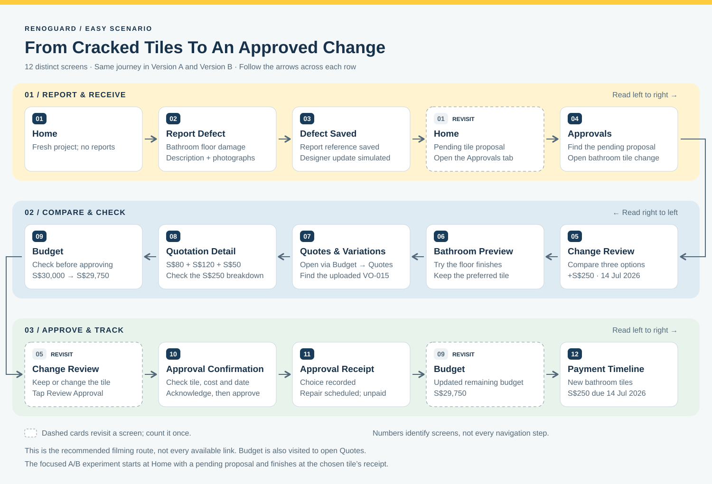

# Iteration 2: scenario and consultation review

[Back to the README](../README.md) · [Design-system guide](design-system.md)

## Reference priorities

The latest consultation request guides the current app. The team’s Figma screens and Maze examples provide ideas, while the attached easy-scenario prose defines the core homeowner journey. The revised navy/yellow construction theme replaces the earlier green/brass/Alice design direction.

The course instructions describe a usual scope of **6–14 views**, depending on the easy scenario. They also require a navigation diagram and screenshots of its views, plus an experiment with **one independent variable, two dependent variables and at least 20 real participants**. The narrated scenario walkthrough is optional in the instructions, but the team plans to record one. A working frontend is sufficient; designer responses, AR and payments can be simulated.

 

## Review against the consultation request

| Area | Current implementation |
| --- | --- |
| Construction theme | Shared navy/yellow palette and an upright, original SVG hard-hat mark. |
| Consistent text | One role-based type scale, with identical A/B comparison names, labels, values and samples. |
| Motion | Loading bar, short screen transitions, an animated Home progress ring and smooth table navigation, with reduced-motion support. |
| Version A | Three horizontally paged options, fixed specification labels, arrows, clickable position indicators and keyboard controls. |
| Version B | Three full-width cards; each has a centred radio inside the right edge with a defined gap from the information. |
| Choice labels | Radio-only controls in both versions. No Select/Selected or Choose this tile text beside the circle. |
| Third finish | Avorio uses an ivory mineral texture, not another opacity setting on the sand overlay. |
| Scenario | Reporting, designer update, comparison, preview, quotation, budget, approval and payment updates remain linked. |
| Focused experiment | Separate A/B links start at Home with a pending proposal, including finding the approval before comparing tiles. |
| Shared implementation | One codebase and one material dataset; no duplicated app folders. |
| Documentation | A concise README with a copyable preview command, detailed setup guide, design-system rules and a live component sheet. |
| Project cleanup | The unused desktop interface is removed; earlier screen explorations remain under drafts. Hosting instructions are omitted from the setup guide. |

The backend is intentionally simulated. The app does not collect Maze answers or send real requests, approvals, payments or messages to a contractor.

 

## Scenario points to settle before recording

Thomas is a first-time renovator who needs traceable agreements, plain-language quotations, cost and timeline visibility, and evidence that defects are fixed. The supplied draft names seven features: Report Defect, Organisation Dashboard, Approval Dashboard, AR Room Preview, Variations & Quotes, Live Project Budget and Payment Timeline. All seven have a working frontend path.

The supplied prose still says **two** proposed replacement tiles. The consultation adds a **third** option, and the app now uses the same three replacements throughout. Update the scenario wording before filming so narration and screens agree. Also correct the payment date **14/07/06** to **14 Jul 2026**.

The figures stay consistent: every option adds **S$250**, completion changes from **1 Jul 2026** to **14 Jul 2026**, available budget changes from **S$30,000** to **S$29,750**, and **New bathroom tiles** becomes an unpaid S$250 milestone due **14 Jul 2026**. Approval changes commitments; it does not process payment.

 

## Walkthrough screen count

[Open the full-size flow diagram](images/easy-scenario-flow.svg). This shows the recommended recording route; it does not restrict the app's other navigation paths. Screen numbers identify distinct views, not every visit. Budget is also visited when opening Quotes from its navigation tabs.

Launch the normal app for a fresh Home screen without reports or hints. From **Profile → Prototype controls**, choose the comparison version, then **Start full walkthrough**. This restarts at Home with optional step hints. The same controls page contains the walkthrough checklist and a hint toggle for clean filming.

The recommended filming path uses **12 distinct views**, counting Home and Budget once even when revisited. This fits the usual **6–14** range described in the instructions; 14 is not a minimum. The eight in-app checklist steps are milestones, not a screen count.

| View | What to show |
| --- | --- |
| 1. Home / Organisation Dashboard | Renovation summary before the report. |
| 2. Report defect | Bathroom, Flooring, damage description and sample photographs. |
| 3. Defect saved | Report reference and simulated designer update. |
| 4. Approvals list | Pending bathroom proposal after returning to Home. |
| 5. Change review | Original specification, three replacements, added cost and revised date. |
| 6. Bathroom preview | Switch through all three finishes; keep the preferred tile selected. |
| 7. Quotes & variations | Open from Budget → Quotes to show the uploaded document list. |
| 8. Quotation detail | S$80 removal/preparation + S$120 tile difference + S$50 laying/grouting. |
| 9. Budget | S$30,000 available before approval; S$29,750 afterwards. |
| 10. Approval confirmation | Chosen tile, S$250 and 14 Jul; acknowledge and approve. |
| 11. Approval receipt | Saved choice, updated budget, scheduled repair and unpaid milestone. |
| 12. Payment timeline | New bathroom tile payment due 14 Jul 2026. |

Revisit Change review as needed between preview, documents and Budget. Direct links can skip the Approvals list or document list, reducing a shorter run to **10 distinct views**; that is a navigation shortcut, not missing functionality. Adding the defect-detail view and Rooms & previews overview would bring the film to **14 distinct views**, if useful to the story. Profile, prototype controls and the checklist are preparation screens and are outside the recorded scenario; adding them merely to reach a number is unnecessary.

Keep the final navigation diagram and at least one screenshot of each scenario view for the assignment. The main README reserves space for the final diagram and high-fidelity video link. Record AI-assisted changes and the team's own review in the required journal rather than filling the project README with submission administration.

 

## Focused A/B experiment

### Loop11 automatic completion pilot

The Loop11 participant links for project **112897 / A** and **112898 / B** now attempt to activate Loop11's existing task-completion button after a real **Sabbia Matte** approval. The receipt remains visible for at least 1.2 seconds before the attempt. This is an undocumented UI adapter, not an official Loop11 API; success URLs still determine the study's success classification.

Normal visits, full walkthroughs, other tiles and direct receipt URLs do not trigger it. A collapsed toolbar is expanded through the Loop11 Alt+X shortcut before task completion. If expansion fails or the toolbar is inaccessible or changed, the receipt prompts the participant to complete the task manually. Add `&l11_autocomplete=0` to a participant link to disable the adapter. Both variants use the same rules and delay.

Before recruitment, pilot each actual participant link: approve Sabbia, verify that the feedback questions appear once, submit the pilot answers, and check success classification and recorded duration in Loop11. The automated adapter tests use a simulated toolbar; they do not verify Loop11's server-side recording. Account for the transition delay when describing measured completion time. Exclude these pilot responses from the experiment results.

Run adapter checks with `node --test tests/loop11-completion.test.cjs`.

**Goal:** compare how the two layouts support reviewing and choosing a replacement tile before approval.

**Independent variable:** comparison presentation — a horizontally paged table versus vertically stacked full-width cards. Keep the material order, text, images, prices, dates, transition duration and final approval safeguards the same. Both require browsing beyond the first option. Do not impose artificial delays to equalise completion times; time is an outcome to measure.

Use `?variant=a&study=quotation` and `?variant=b&study=quotation`. Both start at Home with the same bathroom defect already reported, its quotation pending, no tile chosen and hints off. Participants can use the Needs attention card or the Approvals tab to find the proposal; both versions offer the same routes. Session progress is held in memory and resets on refresh. Use `?variant=a&walkthrough=1` or `?variant=b&walkthrough=1` for the complete walkthrough instead. Opening a direct experiment link starts a fresh session. The in-app A/B switch changes only the comparison layout and preserves the current progress. The default app also starts fresh on every reload and ignores older saved demos. Legacy `study=scenario` links open the fresh Home screen without hints.

Use the same task in both conditions:

> Your designer has proposed replacement bathroom tiles. Starting from your project Home screen, find the pending proposal, review the extra cost and revised completion date, choose Sabbia Matte, and approve the change. Finish when the approval receipt appears.

### Two suggested primary measures

Confirm these with the team and mentor before recruitment:

1. **Correct-task completion time:** from the Home screen at task start to the receipt for Sabbia Matte. This includes finding the pending approval; do not restart the timer when the comparison opens. Agree on a common time limit after piloting. Log wrong choices, timeouts and abandoned attempts separately; do not treat them as successful completion times.
2. **Post-task satisfaction:** “Overall, how satisfied are you with reviewing and approving this change?” Use the same 1–7 scale, anchored Very dissatisfied and Very satisfied, after every attempt.

Completion status is necessary context for interpreting time. If the team chooses accuracy or completion rate as a primary measure instead, replace one of the two above rather than silently expanding the experiment to four dependent variables.

Decide between-subjects or within-subjects in the experiment design. Assign conditions evenly for between-subjects; counterbalance A→B and B→A for within-subjects and consider the learning effect. Recruit at least 20 real participants. Keep device conditions, instructions and help consistent, and do not generate participant responses.

 

## Maze readiness and remaining setup

Both variants share one Vercel deployment: [Version A](https://renoguard-prototype.vercel.app/?variant=a&study=quotation) and [Version B](https://renoguard-prototype.vercel.app/?variant=b&study=quotation). Deployment instructions are kept separate from the local setup guide.

The app mirrors its current study screen in a **screen query parameter**, alongside its in-app fragment. The approved receipt also includes **approved_tile=sabbia** for the target outcome. The starting screen is `screen=overview`; this gives the hosted experiment distinct Home, review, confirmation and outcome addresses while preserving the app session. Set the Maze task start at Home so navigation is included in the recorded time.

Maze documents support for [query-parameter changes in website-test paths](https://help.maze.co/articles/7929597285-website-test-how-are-url-query-parameters-handled-in-live-website-testing). This still needs an actual pilot: do not assume every radio change or carousel swipe becomes a separate Maze path step. See [Maze's HTML-prototype guidance](https://help.maze.co/articles/9607895110-testing-an-html-prototype-in-maze).

Before recruitment:

- Confirm the team's account includes **Website Test**. Maze currently documents this as a paid-plan feature; a Figma Prototype Test and a hosted HTML Website Test are different blocks. See [the website-test requirements](https://help.maze.co/articles/2471284614-website-test-run-usability-tests-on-your-live-websites).
- Use publicly reachable A/B links from the same deployment, not localhost addresses.
- The team's Maze snippet is installed in the shared app entry page, covering both variants. After the updated deployment is ready, verify the base domain in Maze's Connected websites settings and verify each Website Test block.
- Pilot the actual Maze participant links, timing, recordings, satisfaction question and export. Snippet-less and snippet-based modes expose different data.
- Check that the receipt shows **Sabbia Matte** and that the recorded outcome address includes the target material. A generic receipt page alone is insufficient evidence of correct completion.
- Keep each task in one continuous app session. Refreshing intentionally resets the test; the app does not store research answers.

The two team Maze examples were supplied as references for task scope, not as the implementation's source of truth. No live study has been configured or run as part of this UI refinement.
